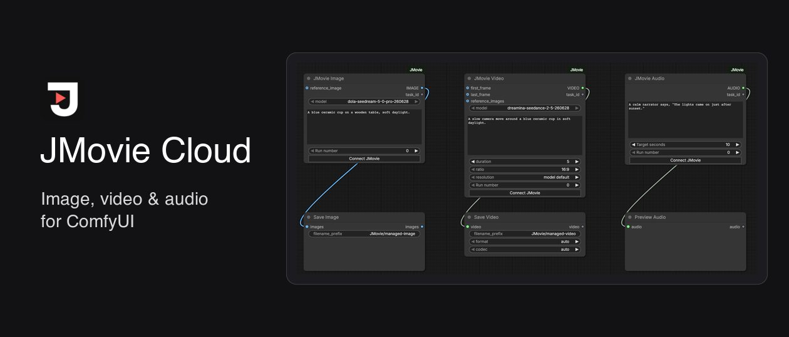
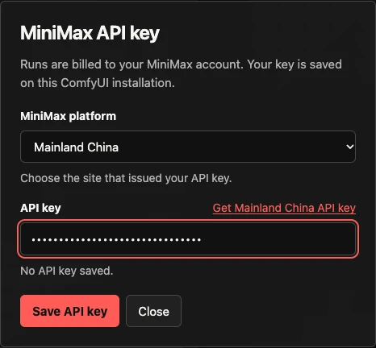

# JMovie Cloud for ComfyUI

Uncensored AI for permitted adult (NSFW) image, video, and audio workflows in ComfyUI. Model and provider content rules apply.

Connect a JMovie API wallet and pay by usage for Seedream 5.0 Pro images, Dreamina Seedance 2.5 video, and Seed Audio 1.0 voice and sound. Start with one of the three bundled workflows.

[Install JMovie Cloud](#install) · [Connect JMovie](#connect-jmovie) · [JMovie API pricing](https://api.j-movie.com/pricing) · [Comfy Registry listing](https://registry.comfy.org/nodes/jmovie-cloud) · [Report an issue on GitHub](https://github.com/jmovie-cloud/ComfyUI-JMovie/issues)



## Install

Requires ComfyUI 0.36.0 or later and Python 3.11 or later. Run ComfyUI as a local, single-user server on localhost.

Install `jmovie-cloud` from [Comfy Registry](https://registry.comfy.org/nodes/jmovie-cloud) with Comfy CLI, then restart ComfyUI.

```sh
comfy node registry-install jmovie-cloud
```

Download the `ComfyUI-JMovie-v*.zip` asset from [GitHub Releases](https://github.com/jmovie-cloud/ComfyUI-JMovie/releases). Extract the `ComfyUI-JMovie` folder into `ComfyUI/custom_nodes`, then restart ComfyUI.

For a Git checkout, run these commands from your ComfyUI folder and restart:

```sh
cd custom_nodes
git clone https://github.com/jmovie-cloud/ComfyUI-JMovie.git
```

Keep one copy of the plugin in `custom_nodes`. [ComfyUI custom node installation guide](https://docs.comfy.org/installation/install_custom_node)

## Connect JMovie

1. In ComfyUI, open **Templates → Extensions** and select **jmovie-image** under **jmovie-cloud** for a Registry install or **ComfyUI-JMovie** for a GitHub install. You can also add a node from **Node Library → JMovie Cloud** or drag an [example workflow JSON](#example-workflows) onto the canvas.
2. Select **Connect JMovie** on the node, then select **Connect JMovie** in the dialog. When the browser tab opens, return to ComfyUI and select **Copy code**. If you closed the tab, select **Open authorization page**.

   

3. In the browser, [sign in to JMovie API](https://api.j-movie.com/sign-in?comfy=1) or choose **Create an account**. On **Connect ComfyUI**, check your account and available balance, paste your own device code, and select **Authorize**.

   

4. Once ComfyUI says **Connected to JMovie API**, close the dialog. If your balance is too low, use **Top up** on the authorization page or open [Add funds & billing](https://api.j-movie.com/console?tab=billing) while signed in. Enter a prompt in the node and select **Run**.

## Example workflows

Open a workflow below on GitHub, select **Download raw file**, and drag the downloaded JSON onto the ComfyUI canvas. The same workflows are available under your installed package in **Templates → Extensions**.

[View the full ComfyUI workflow screenshot](docs/images/jmovie-workflows.webp)

| Node | Default model | Workflow |
| --- | --- | --- |
| JMovie Image | Seedream 5.0 Pro | [Generate and save an image](workflows/jmovie-image.json) |
| JMovie Video | Dreamina Seedance 2.5 | [Generate and save a video](workflows/jmovie-video.json) |
| JMovie Audio | Seed Audio 1.0 | [Generate and preview audio](workflows/jmovie-audio.json) |

JMovie Image accepts an optional reference image. JMovie Video accepts a text prompt, frame anchors, or visual references. JMovie Audio takes a dialogue, narration, or sound prompt. **Target seconds** guides the model, and billing uses the original generated duration reported by the provider. The audio example previews the result. Add **Save Audio (Advanced)** to write an audio file.

## Optional provider API keys

Open **JMovie Cloud → Advanced → BYOK** and add the provider node. Click **Set MiniMax API key** or **Set OpenAI API key**, paste your key, and click **Save API key**. The key is saved on the local ComfyUI installation. New runs can use it immediately. Each provider bills your own account directly.

| Node | Key setup in the node | Workflow and setup |
| --- | --- | --- |
| MiniMax H3 (BYOK) | **Set MiniMax API key**, then select the issuing platform | [MiniMax H3 workflow](workflows/byok/minimax-h3.json) · [International API keys](https://platform.minimax.io/console/keys) · [Mainland China API keys](https://platform.minimax.cn/console/keys) |
| GPT Image (OpenAI BYOK) | **Set OpenAI API key** | [GPT Image workflow](workflows/byok/cloud-image.json) · [OpenAI API keys](https://platform.openai.com/api-keys) · [OpenAI image generation guide](https://developers.openai.com/api/docs/guides/image-generation) |



Open the same settings to replace or remove a saved key. The form shows the key source and keeps previously saved values hidden. Advanced setups can supply `MINIMAX_API_KEY` or `OPENAI_API_KEY` in the ComfyUI startup environment. A key saved in the form takes precedence.

MiniMax keys must match the issuing platform. For a Mainland China startup key, also set `MINIMAX_API_REGION=cn`. Startup keys use the International platform by default.

MiniMax H3 supports text prompts, first and last frames, or reference images. Choose 4–15 seconds at 768P or 2K. GPT Image supports text-to-image and reference-image edits, including GPT Image 2.6 Flare and Sunburst.

## Manage a connection or recover a task

- Choose **Disconnect** in ComfyUI or open [ComfyUI connections](https://api.j-movie.com/comfy/authorize) to revoke access. Access expires after 24 hours, and restarting ComfyUI requires reconnecting.
- Keep the same inputs and run number to recover a JMovie wallet or MiniMax H3 request. Change the run number to submit a new task. To look up a video by task ID, use **Advanced → Resume Cloud Video** for JMovie, or fill in **resume_task_id** on **MiniMax H3 (BYOK)**.
- Results are delivered to ComfyUI as supplier downloads or inline media. Save outputs locally before they expire. An expired download never starts a new paid task.

## Frequently asked questions

### Which Seedance models can I use?

The ComfyUI video node uses Dreamina Seedance 2.5. The JMovie API also offers Seedance 2.0, 2.0 Fast, 2.0 Mini, and 2.5 Flash. [Seedance 2.0 API models](https://api.j-movie.com/models/seedance-2-0) · [Seedance 2.5 API models](https://api.j-movie.com/models/seedance-2-5)

### Do I need a JMovie workbench subscription or a provider API key?

The JMovie API wallet covers the Seedream, Seedance, and Seed Audio nodes. Sign in at [JMovie API](https://api.j-movie.com/) and authorize ComfyUI. These nodes require neither a JMovie workbench seat nor your own provider key.

### Can I use OpenAI GPT Image or MiniMax H3 in ComfyUI?

Yes. Use the [optional BYOK nodes](#optional-provider-api-keys) and enter an official OpenAI or MiniMax API key in the node’s settings. For MiniMax, choose the platform that issued the key, International or Mainland China. The provider bills your account directly.

### Where do generated files go?

The nodes return results to the local ComfyUI workflow. Connect a Save node to write a file on the machine running ComfyUI, or pass the output to the next node.

## Support and development

Use [JMovie API](https://api.j-movie.com/) for ComfyUI account access, wallet billing, and model pricing. The [JMovie production workspace](https://j-movie.com/) is available for browser-based production.

Include the node name, ComfyUI version, and error message with credentials removed. [Report a problem on GitHub](https://github.com/jmovie-cloud/ComfyUI-JMovie/issues)

The default account origin is `https://api.j-movie.com`. For local development, `JMOVIE_CLOUD_BASE_URL` can point to a compatible [JMovie plugin backend](docs/jmovie-platform-contract.md). The local browser and generation checks use synthetic accounts and media. Run `python tests/comfy_smoke.py /absolute/path/to/ComfyUI` from this repository with Playwright, Chrome, and FFmpeg available.
