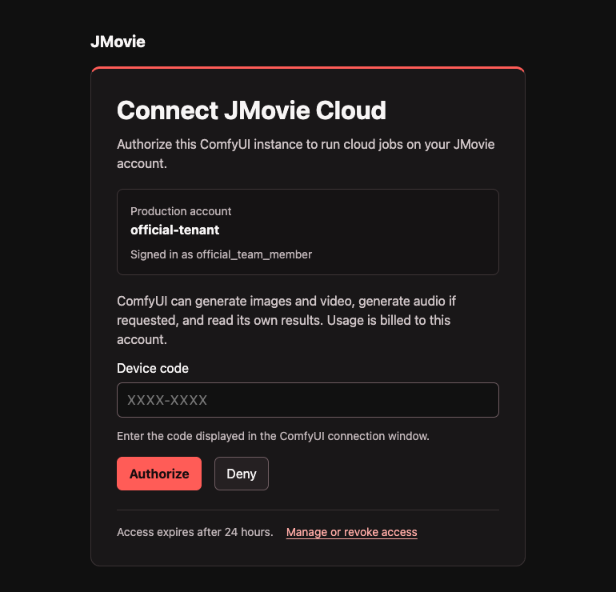

# JMovie Cloud for ComfyUI

Generate images, video, and audio for adult (NSFW) productions in ComfyUI. Connect once with a JMovie API account to use all three nodes. Jobs run in the cloud and are charged to your API wallet based on usage. Supported content depends on the model. [JMovie API pricing](https://api.j-movie.com/pricing)


## Install

Requires ComfyUI 0.36.0 or later and Python 3.11 or later. Run ComfyUI as a local, single-user server on localhost. From your ComfyUI folder, clone the plugin into `custom_nodes`. [ComfyUI custom node installation guide](https://docs.comfy.org/installation/install_custom_node)

```sh
cd custom_nodes
git clone https://github.com/jmovie-cloud/ComfyUI-JMovie.git
```

You can also [download the source ZIP](https://github.com/jmovie-cloud/ComfyUI-JMovie/archive/refs/heads/main.zip). Extract its folder into `custom_nodes` and rename it to `ComfyUI-JMovie`. Keep one copy of the plugin, then restart ComfyUI.

## Connect JMovie

1. In ComfyUI, open **Templates**, choose **ComfyUI-JMovie** under **Extensions**, and select **jmovie-image**. You can also add a node from **Node Library → JMovie Cloud** or drag an [example workflow JSON](#example-workflows) onto the canvas.
2. Select **Connect JMovie** on the node, then select **Connect JMovie** in the dialog. When the browser tab opens, return to ComfyUI and select **Copy code**. If you closed the tab, select **Open authorization page**.

   

3. In the browser, [sign in to JMovie API](https://api.j-movie.com/sign-in?comfy=1) or choose **Create an account**. On **Connect ComfyUI**, check your account and available balance, paste your own device code, and select **Authorize**.

   

4. Once ComfyUI says **Connected to JMovie API**, close the dialog. If your balance is too low, use **Top up** on the authorization page or open [Add funds & billing](https://api.j-movie.com/console?tab=billing) while signed in. Enter a prompt in the node and select **Run**.

## Example workflows

Open a workflow below on GitHub, select **Download raw file**, and drag the downloaded JSON onto the ComfyUI canvas. The same workflows are available under **Templates → ComfyUI-JMovie**.

| Node | Default model | Workflow |
| --- | --- | --- |
| JMovie Image | Seedream 5.0 Pro | [Generate and save an image](workflows/jmovie-image.json) |
| JMovie Video | Dreamina Seedance 2.5 | [Generate and save a video](workflows/jmovie-video.json) |
| JMovie Audio | Seed Audio 1.0 | [Generate and preview audio](workflows/jmovie-audio.json) |

JMovie Image accepts an optional reference image. JMovie Video accepts a text prompt, frame anchors, or visual references. JMovie Audio takes a dialogue, narration, or sound prompt. **Target seconds** guides the model, and billing uses the original generated duration reported by the provider. The audio example previews the result. Add **Save Audio (Advanced)** to write an audio file.

Wallet access to MiniMax H3 and GPT Image is pending. Both providers have a direct API key option below.

## Optional provider API keys

Set your provider key in the ComfyUI server environment and restart ComfyUI. Open **JMovie Cloud → Advanced → BYOK**. Each node calls its provider directly and usage is billed to your provider account.

| Node | Environment variable | Workflow and setup |
| --- | --- | --- |
| MiniMax H3 (BYOK) | `MINIMAX_API_KEY` | [MiniMax H3 workflow](workflows/byok/minimax-h3.json) · [MiniMax API keys](https://platform.minimax.io/console/keys) · [MiniMax video API](https://platform.minimax.io/docs/api-reference/video-generation-v2-create) |
| GPT Image (OpenAI BYOK) | `OPENAI_API_KEY` | [GPT Image workflow](workflows/byok/cloud-image.json) · [OpenAI API keys](https://platform.openai.com/api-keys) · [OpenAI image generation guide](https://developers.openai.com/api/docs/guides/image-generation) |

MiniMax H3 supports text prompts, first and last frames, or reference images. Choose 4–15 seconds at 768P or 2K. GPT Image supports text-to-image and reference-image edits, including GPT Image 2.6 Flare and Sunburst.

## Manage a connection or recover a task

- Choose **Disconnect** in ComfyUI or open [ComfyUI connections](https://api.j-movie.com/comfy/authorize) to revoke access. Access expires after 24 hours, and restarting ComfyUI requires reconnecting.
- Keep the same inputs and run number to recover a JMovie wallet or MiniMax H3 request. Change the run number to submit a new task. To look up a video by task ID, use **Advanced → Resume Cloud Video** for JMovie, or fill in **resume_task_id** on **MiniMax H3 (BYOK)**.
- Results are delivered to ComfyUI as supplier downloads or inline media. Save outputs locally before they expire. An expired download never starts a new paid task.

## Support and development

Include the node name, ComfyUI version, and error message with credentials removed. [Report a problem on GitHub](https://github.com/jmovie-cloud/ComfyUI-JMovie/issues)

The default account origin is `https://api.j-movie.com`. For local development, `JMOVIE_CLOUD_BASE_URL` can point to a compatible [JMovie plugin backend](docs/jmovie-platform-contract.md). The local browser and generation checks use synthetic accounts and media. Run `python tests/comfy_smoke.py /absolute/path/to/ComfyUI` from this repository with Playwright, Chrome, and FFmpeg available.
