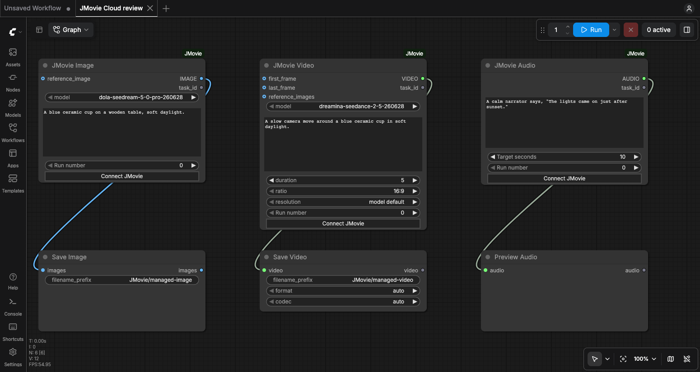
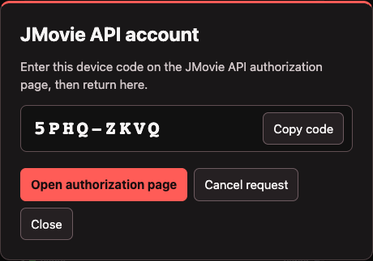

# JMovie Cloud for ComfyUI

Generate images, video, and audio for adult (NSFW) productions in ComfyUI using a [JMovie API account](https://api.j-movie.com/sign-up). Connect once and run all three nodes with your API wallet. Paid jobs use [JMovie API rates](https://api.j-movie.com/pricing) and settle against actual usage. A JMovie studio seat is unnecessary. Model availability depends on the provider's content policy. The [JMovie production workspace](https://j-movie.com) is a separate cloud editing product.



## Install

Use [ComfyUI](https://docs.comfy.org/installation/system_requirements) 0.36.0 or later, with Python 3.11 or later. Run ComfyUI as a local, single-user server on loopback. From its installation folder, run the following commands and restart ComfyUI.

```sh
cd custom_nodes
git clone https://github.com/jmovie-cloud/ComfyUI-JMovie.git
```

For a pinned version, download **Source code (zip)** from [GitHub Releases](https://github.com/jmovie-cloud/ComfyUI-JMovie/releases), extract one copy into `custom_nodes/ComfyUI-JMovie`, and restart ComfyUI. The [Comfy Registry](https://registry.comfy.org/) listing is pending.

## Connect JMovie

1. Open a template from **Templates → ComfyUI-JMovie**, or add a node from **JMovie Cloud**.
2. Click **Connect JMovie** on the node, then **Connect JMovie** in the dialog. Select **Copy code** beside the device code. Use **Open authorization page** to reopen the browser page if needed.
3. Sign in to [JMovie API](https://api.j-movie.com/sign-in?comfy=1). Paste the code on the authorization page, review the account and wallet, then select **Authorize**.
4. Return to ComfyUI. When the dialog shows that you are connected, close it, enter a prompt, and select **Run**. Manage your balance and add funds in [Add funds & billing](https://api.j-movie.com/console?tab=billing).




## Example workflows

Open a linked workflow on GitHub, select **Download raw file**, and drag the JSON onto the ComfyUI canvas. The same workflows are available in the template browser.

| Node | Default model | Workflow |
| --- | --- | --- |
| JMovie Image | Seedream 5.0 Pro | [Generate and save an image](workflows/jmovie-image.json) |
| JMovie Video | Dreamina Seedance 2.5 | [Generate and save a video](workflows/jmovie-video.json) |
| JMovie Audio | Seed Audio 1.0 | [Generate and preview audio](workflows/jmovie-audio.json) |

JMovie Image supports an optional reference image. Choose a hosted GPT Image model for general image generation or editing with the same API wallet. JMovie Video offers Seedance 2.5 and MiniMax H3 for prompts, frame anchors, or visual references. JMovie Audio takes a dialogue, narration, or sound prompt and returns a native ComfyUI audio output. **Target seconds** guides generation. Billing uses the duration reported by the model before post-processing.

## Optional GPT Image with your own OpenAI API key

**JMovie Cloud → Advanced → BYOK → GPT Image (OpenAI BYOK)** is the only node that accepts your own provider key. Set `OPENAI_API_KEY` in the ComfyUI server environment and restart ComfyUI. The node requests `api.openai.com` directly and OpenAI bills your account. [GPT Image workflow](examples/byok/cloud-image.json) · [OpenAI API keys](https://platform.openai.com/api-keys) · [OpenAI image generation guide](https://developers.openai.com/api/docs/guides/image-generation)

## Manage a connection or recover a task

- Choose **Disconnect** in ComfyUI or open [ComfyUI connections](https://api.j-movie.com/comfy/authorize) to revoke access. Access expires after 24 hours, and restarting ComfyUI requires reconnecting.
- Keep the same inputs and run number to recover a managed request. Change the run number to submit a new task. **Advanced → Resume Cloud Video** can retrieve a JMovie video by task ID while its supplier link is valid.
- Results are delivered to ComfyUI as supplier downloads or inline media. Save outputs locally before they expire. An expired download never starts a new paid task.

## Support and development

Report plugin problems in [GitHub Issues](https://github.com/jmovie-cloud/ComfyUI-JMovie/issues). Include the node name, ComfyUI version, and error message with credentials removed.

The default account origin is `https://api.j-movie.com`. For local development, `JMOVIE_CLOUD_BASE_URL` can point to a compatible [JMovie plugin backend](docs/jmovie-platform-contract.md). The local browser and generation checks use synthetic accounts and media. Run `python tests/comfy_smoke.py /absolute/path/to/ComfyUI` from this repository with Playwright, Chrome, and FFmpeg available.

The initial Registry package is `jmovie-cloud` version `0.1.0`. See the [Comfy Registry publishing guide](https://docs.comfy.org/registry/publishing) for publisher setup.
